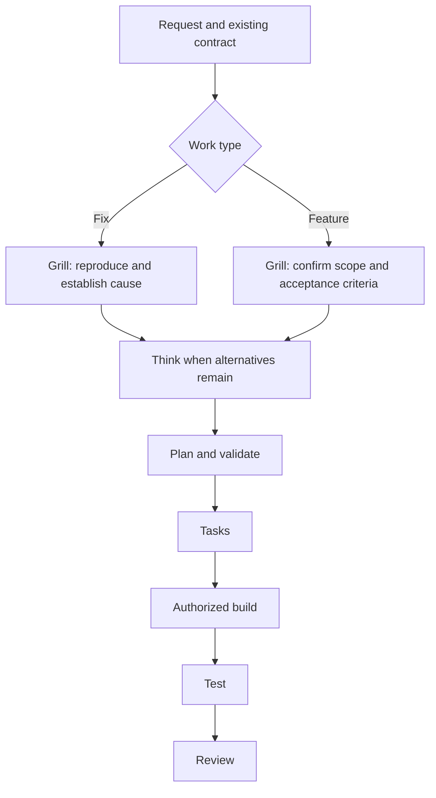

# zipsa-co-command

Nine skills for fix and feature work, with independent planning and review from a second agent.
Claude Code leads the Claude distribution and consults Codex through MCP. Codex leads the
Codex distribution and consults a read-only Claude CLI session. The lead agent implements;
its peer reviews the approach. Peer agreement does not grant approval or prove correctness.

## Skills

| Skill | Purpose |
|---|---|
| `zipsa-workflow` | Coordinate one stage per invocation, track evidence and resume interrupted work. |
| `zipsa-grill` | Clarify requirements; gather authorized reproduction and cause evidence for fixes. |
| `zipsa-think` | Compare meaningful alternatives when a choice remains. |
| `zipsa-plan` | Map requirements to a minimal implementation plan and acceptance checks. |
| `zipsa-validate` | Review the plan against requirements and concrete risks. |
| `zipsa-tasks` | Produce ordered tasks with contract-derived test scenarios. |
| `zipsa-build` | Implement authorized tasks and verify runnable task-level criteria. |
| `zipsa-test` | Execute required checks on the actual change and preserve failures and limitations. |
| `zipsa-review` | Review requirements coverage, code quality and current verification evidence. |

## Fix and feature routing

Classification follows the existing behavior contract, not an issue label. A fix restores
required behavior; a feature adds or intentionally changes behavior. Mixed work keeps
requirement-specific classifications. Existing valid evidence can satisfy a gate.



The controller runs at most one stage per invocation. A status request does not start work.
Repository approval rules remain in force. A substantive design departure returns to
planning and validation before implementation, including standalone build use. Two failed
fixes sharing a premise require testing that premise before another fix. Performance
measurement rules apply only to performance work.

## Install and use

See [installation](docs/installation.md) for Claude marketplace installation, direct copies,
Codex installation, dependencies, updates and verification.

- Claude plugin: `/zipsa-commands:zipsa-workflow <request or workflow.md>`.
- Direct Claude skills: `/zipsa-workflow <request or workflow.md>`.
- Codex: `$zipsa-workflow <request or workflow.md>`.

The workflow checkpoint preserves approvals, artifact references and unfinished work.
The offline HTML guide explains outcomes and blockers; it is presentation data, not execution
state or approval. Test evidence is tied to the actual code, fixtures, configuration and environment.

## Distribution layout

- `plugins/zipsa-commands/skills/` contains Claude-led skills and their resources.
- `plugins/zipsa-commands/.claude-plugin/plugin.json` identifies the Claude plugin.
- `codex/skills/` contains Codex-led skills and their resources.
- Each host's `zipsa-workflow/` includes shared references, the offline renderer and its tests.

Keep each host's nine sibling skill directories together. Do not install both distributions
into one host's skills directory: their lead/peer roles and tool calls differ.

## Verify a checkout

Use the Python version in `.tool-versions`, managed by asdf, and uv:

```sh
uv sync --locked --python "$(asdf which python3)"
uv run python -m unittest discover -s tests -v
uv run python -m unittest discover -s plugins/zipsa-commands/skills/zipsa-workflow/tests -v
uv run python -m unittest discover -s codex/skills/zipsa-workflow/tests -v
claude plugin validate --strict plugins/zipsa-commands
claude plugin validate --strict .claude-plugin/marketplace.json
```

Behavioral checks for skill changes are described in each distribution's
`zipsa-workflow/references/skill-validation.md`. File validation and renderer tests do not
prove that an agent follows a workflow. Native Claude execution was unavailable during this
update because the account returned `403 oauth_not_allowed_for_organization`; this is not a
Claude behavioral pass. Independent Codex smoke checks exercised both instruction variants.

The [release scope](docs/v0.0.5-roadmap.md) distinguishes this update from earlier proposals.

## License

MIT.
